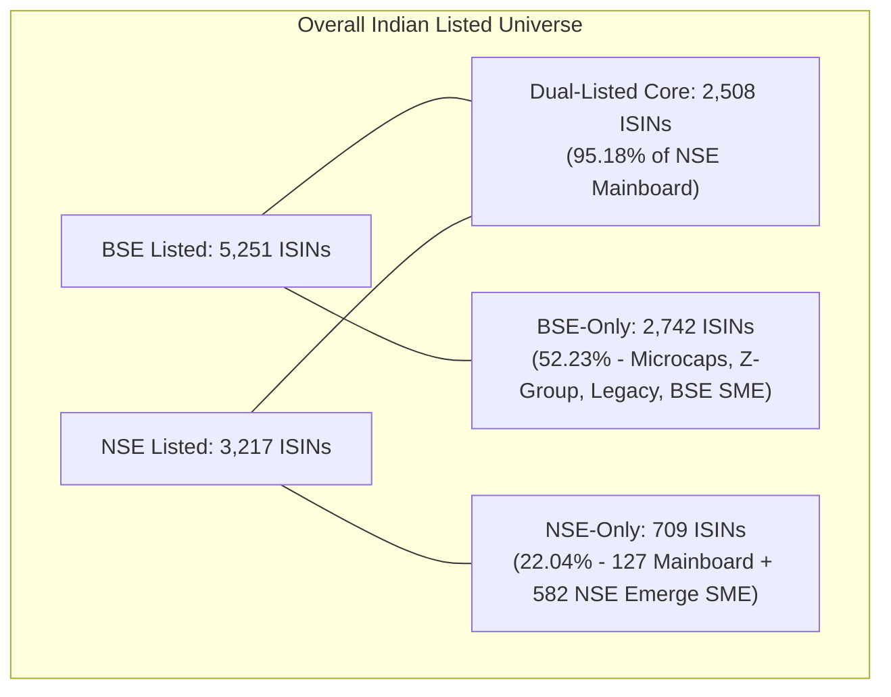
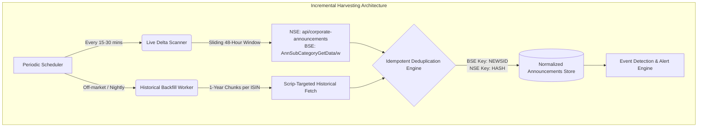

# Cross-Exchange Matching, Historical Data & Regulatory Compliance Architecture

**Target Exchanges:** National Stock Exchange of India (NSE) & Bombay Stock Exchange (BSE)  
**Regulatory Framework:** Securities and Exchange Board of India (SEBI) LODR Regulations, 2015  
**Data Artifacts Location:** `research/common/samples/`  
**Date of Empirical Validation:** November 2026

---

## 1. Executive Summary & Core Architectural Takeaways

A robust quantitative strategy driven by corporate announcements and earnings results in the Indian equity markets cannot rely solely on a single exchange ticker or naive string-matching algorithms. NSE and BSE exhibit distinct operational structures, numbering conventions, listing rosters, and API architectures:

1. **ISIN is the Absolute Invariant Anchor:** The International Securities Identification Number (ISIN, ISO 6166) is the only immutable, exchange-independent primary key. While tickers (`SYMBOL` on NSE vs `scrip_id` / `SCRIP_CD` on BSE) and company names diverge or mutate through corporate reorganizations, the 12-character ISIN uniquely maps securities.
2. **Empirical Listing Overlap:**
   - **NSE Mainboard on BSE:** **95.18%** of NSE-listed equities (2,508 out of 2,635) are dual-listed on BSE.
   - **BSE Mainboard on NSE:** Only **47.76%** of BSE-listed equities are available on NSE due to thousands of legacy, small-cap, regional, and restricted scrips (Groups X, XT, Z, P) residing exclusively on BSE.
   - **SME Cross-Listing:** Under SEBI ICDR regulations, **0.00%** of SME scrips are dual-listed. NSE Emerge (582 scrips) and BSE SME (566 scrips) represent mutually exclusive universes until formal migration to the Mainboard occurs.
3. **Historical Data Accessibility (15+ Years):** Live endpoint interrogation confirms that both NSE (`/api/corporate-announcements`) and BSE (`/BseIndiaAPI/api/AnnSubCategoryGetData/w`) retain structured corporate announcements and board meeting intimations dating back to at least **2008**.
4. **Query Window Limits:** Open market-wide queries across all equities return massive payloads (>10MB / 13,000+ records for a single month) and time out beyond 30-day windows. Safe historical harvesting requires **per-symbol querying** (1-year chunks) or **incremental 7-day sliding delta windows**.
5. **Regulatory Predictability (SEBI LODR):** Corporate announcement frequency is strictly governed by **Regulation 29** (minimum 2 working days advance notice for board meetings) and **Regulation 33** (45-day deadline for Q1-Q3; 60-day deadline for Q4/annual audited results). This creates predictable, high-signal announcement clustering across Indian markets.

---

## 2. Cross-Exchange Mapping via ISIN

### 2.1 Why ISIN is the Primary Unique Key
Trading systems often fail when attempting to match Indian equities using ticker symbols or corporate names:
- **Identifier Fragmentation:** NSE utilizes alphanumeric tickers (`SYMBOL`), e.g., `RELIANCE`, `TCS`, `INFY`. BSE primarily indexes scrips via a **6-digit numeric code** (`SCRIP_CD`), e.g., `500325`, `532540`, `500209`. While BSE maintains an alphanumeric `scrip_id`, API endpoints for announcements, corporate actions, and circulars strictly require the numeric scrip code.
- **ISIN Structural Invariance:** Under ISO 6166, the National Securities Depository Limited (NSDL) and Central Depository Services India Limited (CDSL) assign a standardized 12-character alphanumeric code:
  $$\text{ISIN} = \underbrace{\text{IN}}_{\text{Country Code}} + \underbrace{\text{E}}_{\text{Security Type (E=Equity)}} + \underbrace{\text{002A01}}_{\text{Issuer ID + Issue Class}} + \underbrace{\text{018}}_{\text{Security Serial + Luhn Check Digit}}$$
- **Immutability:** An ISIN remains constant across exchange ticker changes, corporate rebranding, and exchange group transitions.

### 2.2 Empirical Matching Results
Using live master files fetched from NSE (`EQUITY_L.csv`) and BSE (`ListofScripData`), we executed cross-matching scripts (`research/common/samples/isin_matcher.py` and `comprehensive_cross_matcher.py`).

```
+-----------------------------------------------------------------------------------------+
|                               EQUITY UNIVERSE BREAKDOWN                                 |
+------------------------------------+------------------------------------+---------------+
| Segment                            | NSE Count                          | BSE Count     |
+------------------------------------+------------------------------------+---------------+
| Mainboard Active Equities          | 2,635                              | 4,686         |
| SME Exchange Equities              | 582                                | 566           |
| Total Active Equity Records        | 3,217                              | 5,252         |
| Unique Active ISINs                | 3,217                              | 5,251*        |
+------------------------------------+------------------------------------+---------------+
| *Note: 2 BSE scrips (Chase Bright Steel & Pushpsons Ind.) have ISIN marked "NA" (Group Y)|
+-----------------------------------------------------------------------------------------+
```

#### Dual-Listing Statistics

1. **Mainboard Only:**
   - **Common Dual-Listed ISINs:** **2,508**
   - **NSE Mainboard Listed on BSE:** **95.18%** ($\frac{2508}{2635}$)
   - **BSE Mainboard Listed on NSE:** **47.76%** ($\frac{2508}{5251}$)
   - **NSE-Only Equities:** 127 securities (4.82%)
   - **BSE-Only Equities:** 2,743 securities (52.24%)

2. **Combined Universe (Mainboard + SME):**
   - **Total Common ISINs:** **2,508**
   - **NSE Combined on BSE:** **77.96%** ($\frac{2508}{3217}$)
   - **BSE Combined on NSE:** **47.77%** ($\frac{2508}{5251}$)
   - **NSE-Only Combined:** 709 securities (22.04%, composed of 127 Mainboard + 582 SME)
   - **BSE-Only Combined:** 2,742 securities (52.23%)



### 2.3 Handling Single-Exchange vs Dual-Listed Companies

| Category | Population | Liquidity / Volatility Profile | Strategy Handling & Routing |
| :--- | :--- | :--- | :--- |
| **Dual-Listed** | 2,508 scrips | Highest liquidity, institutional coverage, Nifty 500, F&O universe | Primary pricing on NSE (tighter spread); announcements ingested from both NSE and BSE feeds to capture timestamp leads (often filing times differ by 1-5 minutes). |
| **BSE-Only** | 2,742 scrips | Microcaps, B/X/XT groups, illiquid legacy firms, Z-group surveillance | Execution must route strictly to BSE; lower liquidity constraints, wider bid-ask spreads, circuit limits (2% or 5%). |
| **NSE-Only** | 127 mainboard + 582 SME | Emerging growth, exclusive NSE IPOs, NSE Emerge platform | Execution routed strictly to NSE; SME requires trading in fixed lot sizes (e.g., 500, 1000, 2000 shares) rather than single shares. |

### 2.4 Edge Cases and Mitigation Architecture

#### 1. Name Differences (106 Confirmed Instances in Master)
Corporate legal names differ markedly across exchange filings due to abbreviations, legal forms, and historical records:
- **Empirical Examples:**
  - NSE: `Agri- Tech (India) Limited` $\leftrightarrow$ BSE: `Agri- Tech (India) Ltd`
  - NSE: `Austin Engineering Company Limited` $\leftrightarrow$ BSE: `Austin Engineering Company Ltd`
  - NSE: `Twentyfirst Century Management Services Limited` $\leftrightarrow$ BSE: `Twentyfirst Century Management Services Ltd`
  - NSE: `Berger Paints India Limited` $\leftrightarrow$ BSE: `Berger Paints India Ltd`
- **Mitigation:** Never execute string matching on company names. Normalize company names solely for UI display (strip `LTD`, `LIMITED`, punctuation, whitespace). Maintain ISIN as foreign key.

#### 2. Symbol Discrepancies & Scrip Codes
- NSE Symbol does not always match BSE alphanumeric `scrip_id`:
  - `INE467D01017`: NSE `SYMBOL` = `VIRAT` $\leftrightarrow$ BSE `Scrip_Name` = `Brahm Virat Industries Corporation Ltd`, BSE code = `526640`.
- **Mitigation Master Schema:**
  ```python
  class SecurityMasterRecord(BaseModel):
      isin: str               # Primary unique invariant (e.g., "INE002A01018")
      company_name: str       # Canonical normalized name
      nse_symbol: Optional[str]   # "RELIANCE"
      nse_series: Optional[str]   # "EQ", "BE", "SM"
      bse_code: Optional[int]     # 500325 (CRITICAL for BSE API endpoints)
      bse_scrip_id: Optional[str] # "RELIANCE"
      bse_group: Optional[str]    # "A", "B", "M", "T", "Z"
      market_segment: str         # "MAINBOARD" | "SME"
      is_dual_listed: bool
  ```

#### 3. Multiple Share Classes & Differential Voting Rights (DVR)
- Companies issuing ordinary shares alongside Class A / DVR shares share the same corporate entity and issuer ID, but **must have distinct ISINs**:
  - `GATECH` (GACM Technologies Ltd, EQ): `INE224E01028`
  - `GATECHDVR` (GACM Technologies Ltd, DVR): `INE224E01036`
  - Historical Tata Motors: `TATAMOTORS` (`INE155A01022`) vs `TATAMTRDVR` (`INE155A01014`)
- **Mitigation:** The 4th through 8th characters of Indian ISINs indicate the issuer (`INE224E`), while characters 9-10 indicate security class (`01` = Equity Ordinary, `02`/`03` = DVR/Preference). Tracking by full 12-digit ISIN prevents catastrophic cross-contamination between ordinary shares and DVR discount spreads.

#### 4. SME to Mainboard Migration
- Under SEBI (Issue of Capital and Disclosure Requirements) Regulations, Chapter IX, an SME company meeting paid-up capital (>₹10 Cr to ₹25 Cr) and net-worth criteria can migrate from SME to Mainboard:
  - On NSE: Series changes from `SM` / `ST` to `EQ`.
  - On BSE: Group changes from `M` / `MT` to `B` or `T`.
  - **Market Lot Changes:** Changes from lot trading (e.g. 1,000 shares) to a single share market lot.
  - **ISIN Invariance:** The ISIN remains unchanged unless capital reduction/consolidation occurred.
  - **Cross-Listing Trigger:** Upon mainboard migration, the entity is eligible to apply for listing on the opposite exchange. The security master synchronizer must detect series change events and re-evaluate cross-exchange membership.

---

## 3. Historical Announcements & Board Meeting Data Accessibility

### 3.1 Historical Depth Verification
Live programmatic tests against NSE and BSE production endpoints confirm that archives extend **15+ years** into history:

```
+------------------------------------------------------------------------------------------+
|                     EMPIRICAL HISTORICAL QUERY RESULTS FOR RELIANCE                      |
+-------+-----------------------------+-----------------------------+----------------------+
| Year  | NSE Corporate Announcements | BSE Corporate Announcements | NSE Board Meetings   |
+-------+-----------------------------+-----------------------------+----------------------+
| 2024  | Status 200 (33 records)     | Status 200 (34 records)     | Status 200 (10 recs) |
| 2022  | Status 200 (37 records)     | Status 200 (39 records)     | Status 200 (4 recs)  |
| 2020  | Status 200 (5 records)      | Status 200 (23 records)     | Status 200 (6 recs)  |
| 2018  | Status 200 (11 records)     | Status 200 (13 records)     | Status 200 (5 recs)  |
| 2015  | Status 200 (10 records)     | Status 200 (12 records)     | Available            |
| 2012  | Status 200 (11 records)     | Status 200 (12 records)     | Available            |
| 2008  | Status 200 (4 records)      | Status 200 (4 records)      | Available            |
+-------+-----------------------------+-----------------------------+----------------------+
```

### 3.2 Endpoint Architecture & Date-Range Constraints

#### NSE Corporate Announcements & Board Meetings
- **Announcements URL:** `https://www.nseindia.com/api/corporate-announcements`
- **Board Meetings URL:** `https://www.nseindia.com/api/corporate-board-meetings`
- **Parameters:**
  - `index`: `equities`
  - `from_date`: `DD-MM-YYYY`
  - `to_date`: `DD-MM-YYYY`
  - `symbol`: e.g., `TCS`, `RELIANCE` (optional, but essential for large date ranges)
- **Observed Constraints:**
  - **Market-wide queries (no symbol):**
    - 7-day query: 4,770 records (~3.3 MB) — Returns cleanly in ~1.5s.
    - 30-day query: 13,410 records (~9.5 MB) — Returns in ~3.8s.
    - 90-day / 1-year query: Generates payloads exceeding 40–150 MB, causing gateway timeouts (`curl 28: Operation timed out after 10000ms`).
  - **Symbol-specific queries:**
    - Full 1-year window for `TCS`: 275 records, returns in <400ms.
    - Full 1-year window for `RELIANCE`: 416 records, returns in <500ms.

#### BSE Corporate Announcements & Board Meetings
- **Announcements URL:** `https://api.bseindia.com/BseIndiaAPI/api/AnnSubCategoryGetData/w`
- **Board Meetings URL:** `https://api.bseindia.com/BseIndiaAPI/api/BoardMeeting/w`
- **Parameters:**
  - `strScrip` / `scripcode`: 6-digit scrip code (e.g., `500325`)
  - `strPrevDate` / `fromdate`: `YYYYMMDD`
  - `strToDate` / `todate`: `YYYYMMDD`
  - `strType`: `C` (Company)
  - `strSearch`: `P` (Period)
  - `strCat`: `-1` (All categories)
  - `pageno`: Integer page index
- **Observed Constraints:**
  - BSE queries without `strScrip` across all companies are capped and aggressively throttled by Akamai CDN if date range spans beyond 7-15 days.
  - Queries with `strScrip` return JSON with schema: `{"Table": [...], "TotalPageCnt": N}` and can query multi-year intervals cleanly.

### 3.3 Incremental Archive Architecture

Building a resilient, complete historical archive requires a **Two-Tier Synchronization Pipeline**:



#### Synchronization Principles:
1. **Delta Windowing (Live):** Run market-wide sliding window of $[T - 48\text{ hrs}, T]$ every 15–30 minutes during market hours. The 48-hour overlap guarantees coverage even if network blips or exchange updates occur retroactively.
2. **Backfill Segmentation (Historical):** Loop through the Security Master ISIN by ISIN. For each scrip, partition history into **1-year chunks** (`01-01-YYYY` to `31-12-YYYY`).
3. **Primary Deduplication Keys:**
   - **BSE:** UUID field `NEWSID` (e.g., `081fa647-53ee-4768-b5f5-a6fd5bf91862`). Completely unique per filing.
   - **NSE:** Composite deterministic hash:
     $$\text{NSE\_ID} = \text{SHA256}(\text{symbol} + \text{an\_dt} + \text{desc} + \text{attmnt\_filename})$$
4. **Checkpointing & State Recovery:** Maintain a SQLite/PostgreSQL checkpoint table recording `(isin, exchange, start_date, end_date, record_count, status, last_fetched_at)`.

---

## 4. Exchange Terms of Use and Access Restrictions

### 4.1 Legal & Scraping Policies Analysis

#### National Stock Exchange of India (NSE)
- **Terms of Use Clause:** Explicitly prohibits automated harvesting:
  > *"User is prohibited to conduct any systematic or automated data collection activities (including scraping, data mining, data extraction and data harvesting) on or in relation to our Website / Mobile Application."*
- **Robots.txt Analysis:**
  ```
  User-agent: *
  Allow: /
  Disallow: /market-data-test
  Sitemap: https://www.nseindia.com/sitemap.xml
  ```
  While `robots.txt` technically allows `/` (with only `/market-data-test` disallowed), the legal Terms of Use restrict automated high-frequency harvesting and non-personal redistribution.
- **Enforcement Mechanisms:** NSE implements IP-based rate limiting, browser header inspection, cookie validation (`nsit`, `nseappid`), and Cloudflare / Akamai bot management.

#### Bombay Stock Exchange (BSE)
- **Terms of Use & Disclaimer:** Data is provided strictly on an *"as is where is basis"* for individual non-commercial informational use. Systematic automated harvesting, deep linking, and commercial re-dissemination without written agreement are prohibited.
- **Robots.txt & WAF:** BSE routes all web traffic through an Akamai edge network (`akamai-grn`). Non-browser user agents or automated patterns lacking proper browser signatures receive HTTP `403 Forbidden`.
- **Statutory Risks in India:**
  - **IT Act, 2000 (Section 43 & 66):** Penalizes unauthorized extraction, disruption, or circumventing technological access controls.
  - **Digital Personal Data Protection (DPDP) Act, 2023:** Exchange filings frequently contain personal identification data of directors, promoters, and compliance officers (PAN numbers, home addresses in older filings, DIN numbers). Automated data warehouses must sanitize personally identifiable information (PII).

### 4.2 Responsible & Non-Disruptive Access Guardrails

For quant research, event monitoring, and backtesting, scripts must adhere to strict ethical and operational standards:

```python
# Recommended Operational Parameters
SCRAPER_COMPLIANCE_CONFIG = {
    "min_request_interval_seconds": 2.0,       # 1.5s to 3.0s delay between calls
    "jitter_range_seconds": (0.5, 1.5),         # Random jitter to prevent harmonic load
    "max_concurrent_workers": 2,                # Never use multi-threaded flooding
    "session_priming_required": True,           # Hit exchange home page first to accept cookies
    "custom_headers": {
        "User-Agent": "Mozilla/5.0 (Windows NT 10.0; Win64; x64) AppleWebKit/537.36 ...",
        "Accept-Language": "en-US,en;q=0.9",
        "Referer": "https://www.nseindia.com/companies-listing/corporate-filings-announcements"
    },
    "backoff_policy": {
        "initial_backoff_seconds": 5,
        "max_backoff_seconds": 60,
        "exponential_factor": 2.0,
        "retry_on_status": [403, 429, 502, 503, 504]
    },
    "caching": {
        "security_master_ttl_hours": 24,       # Refresh scrip masters once daily
        "historical_archive_immutable": True   # Past years never re-queried once checkpointed
    }
}
```

### 4.3 Commercial Alternative: Authorized Data Feeds
For production, live commercial execution, and institutional trading:
- **NSE Data & Analytics Ltd (DotEx):** The dedicated commercial arm providing official real-time, 15-minute delayed, end-of-day (EOD), and corporate action feeds via direct API / SFTP feeds.
- **BSE Data Feeds:** Formal licensed data feeds for corporate filings and bhavcopy through BSE's Market Data Department.

---

## 5. SEBI LODR Regulatory Framework & Announcement Patterns

The corporate announcement lifecycle in India is strictly bound by statutory deadlines defined in the **Securities and Exchange Board of India (Listing Obligations and Disclosure Requirements) Regulations, 2015**. Understanding these clauses enables quants to anticipate announcement dates and model filing windows.

### 5.1 SEBI LODR Regulation 29: Prior Intimation of Board Meetings

#### Regulatory Requirement:
Under **Regulation 29(1)(a)** read with **Regulation 29(2)**:
- A listed entity **shall give prior intimation** to the stock exchanges of board meetings wherein financial results (quarterly, half-yearly, or annual) are to be considered.
- **Timeline:** The notice must be submitted **at least two working days in advance**.
- **Working Day Computation Rule:** The computation of 2 working days **strictly excludes** both:
  1. The date on which the intimation is sent, AND
  2. The date of the board meeting itself.
  - Furthermore, "working days" refers to official trading days of the stock exchanges (Saturdays, Sundays, and exchange trading holidays do not count).

$$\text{Minimum Notice Window} = [\text{Intimation Date} + 1 \text{ Trading Day} + 1 \text{ Trading Day}] \longrightarrow \text{Board Meeting Date}$$

*Concrete Scenario:*
- Intimation dispatched to exchange: **Monday morning**
- Working day 1 excluded from meeting: **Tuesday**
- Working day 2 excluded from meeting: **Wednesday**
- Earliest permissible Board Meeting date: **Thursday**

#### Quantitative Implications:
Every quarterly earnings release is preceded by a board meeting intimation filing at least 2 working days (and typically 3 to 10 calendar days) prior. This provides quant algorithms with an unambiguous early-warning signal, establishing the exact calendar date of the pending earnings release.

### 5.2 SEBI LODR Regulation 33: Financial Results Deadlines

Under **Regulation 33(3)**:

```
+-----------------------------------------------------------------------------------------+
|                        SEBI REGULATION 33 FINANCIAL RESULT DEADLINES                     |
+--------------------+-----------------------+---------------------+----------------------+
| Quarter / Period   | Financial Period End  | Statutory Deadline  | Calendar Computation |
+--------------------+-----------------------+---------------------+----------------------+
| Q1 (First Quarter) | June 30               | August 14           | Within 45 days       |
| Q2 (Second Quarter)| September 30          | November 14         | Within 45 days       |
| Q3 (Third Quarter) | December 31           | February 14         | Within 45 days       |
| Q4 & Full Year     | March 31              | May 30              | Within 60 days       |
+--------------------+-----------------------+---------------------+----------------------+
```

- **Q1, Q2, Q3 (Regulation 33(3)(a)):** The listed entity must submit quarterly standalone and consolidated financial results to the exchanges within **45 days** from the end of the quarter, accompanied by a Limited Review Report (LRR) from statutory auditors.
- **Q4 / Annual Audited Results (Regulation 33(3)(d)):** For the final quarter, the entity can submit either unaudited quarterly results within 45 days or full **annual audited financial results within 60 days** from the end of the financial year (May 30). In practice, >95% of listed Indian companies elect the 60-day window to approve full audited annual accounts simultaneously.

### 5.3 SEBI LODR Regulation 30: Board Meeting Closure & 30-Minute Disclosure Rule

Under **Regulation 30(6)** read with **Schedule III, Part A, Para A(4)**:
- The outcome of the meeting of the Board of Directors considering financial results, dividends, bonus shares, capital alteration, or buybacks **must be disclosed to the stock exchanges within 30 minutes of the closure of the board meeting**.
- **Timing Pattern:**
  - Board meetings held during market hours: Results hit the tape mid-session, causing immediate volatility spikes and price discovery.
  - Board meetings concluding post-market (between 4:00 PM and 8:30 PM IST): Results are absorbed overnight; price reaction occurs at market open ($T+1$).

### 5.4 Macro Announcement Patterns & Earnings Season Clustering

Because Regulations 29 and 33 establish fixed calendar anchors, corporate announcements follow a predictable four-wave seasonal cadence each quarter:

```mermaid
gantt
    title Indian Corporate Earnings Cadence (Quarter Ending Dec 31 / Q3 Example)
    dateFormat  YYYY-MM-DD
    axisFormat  %d-%b
    
    section Regulatory Window
    Q3 Quarter Closes             :milestone, m1, 2026-12-31, 0d
    Reg 33 Deadline (45 Days)     :milestone, m2, 2027-02-14, 0d
    
    section Announcement Waves
    Wave 1: IT Frontrunners (TCS, INFY, WIPRO) :active, 2027-01-08, 2027-01-18
    Wave 2: Financials & Large Caps (Banks, NBFCs, Auto) : 2027-01-18, 2027-01-30
    Wave 3: Mid-Cap General Reporting : 2027-01-30, 2027-02-05
    Wave 4: Small-Cap / Late-Filing Deluge (65%+ of market) :crit, 2027-02-05, 2027-02-14
```

#### Behavioral Phases of the Earnings Cycle:
1. **Frontrunners (Days 10 to 18):**
   - Major Tier-1 IT companies (TCS, Infosys, HCL Technologies, Wipro) historically report within 10 to 18 days of quarter close.
   - High data cleanliness, negligible compliance delays.
2. **Core Bluechips & Banking (Days 18 to 30):**
   - Private and public sector banks, large NBFCs, FMCG majors, and heavy engineering firms report in weeks 3 and 4.
3. **The Small & Mid-Cap Deluge (Final 10 Days before Deadline):**
   - **Over 65% of all listed companies file their board meeting intimations and financial results within the last 10 calendar days before the statutory deadline** (e.g., August 4–14, November 4–14, February 4–14, and May 20–30).
   - Exchange filing servers experience peak load; API query latency increases.
   - The density of board meetings during this 10-day window reaches 300 to 700 companies per day.
4. **Off-Market & Weekend Filing Phenomenon:**
   - Companies with distressed, declining, or volatile earnings disproportionately schedule board meetings on Friday afternoons or Saturday mornings, filing results late Friday evening or over the weekend to dampen immediate market panic.

---

## 6. Summary Comparison Matrix

| Dimension | National Stock Exchange (NSE) | Bombay Stock Exchange (BSE) | Unified Architecture Recommendation |
| :--- | :--- | :--- | :--- |
| **Primary Ticker** | `SYMBOL` (e.g., `RELIANCE`) | `SCRIP_CD` (e.g., `500325`) | Maintain dual-key lookup anchored by **ISIN** (`INE002A01018`). |
| **Active Mainboard Equities**| 2,635 | 4,686 | 2,508 dual-listed; 127 NSE-only; 2,743 BSE-only. |
| **SME Cross-Listing** | 582 scrips on NSE Emerge | 566 scrips on BSE SME | **0% cross-listing** due to SEBI ICDR rules; treat as isolated pools. |
| **Historical Depth** | Back to 2008 (15+ yrs verified) | Back to 2008 (15+ yrs verified) | Historical backfill is viable back to 2008 for both venues. |
| **API Architecture** | REST JSON (`api/corporate-announcements`) | REST JSON (`AnnSubCategoryGetData/w`) | Standardize into unified `CanonicalAnnouncement` schema. |
| **Query Bottlenecks** | Timeouts on market-wide ranges >30 days | Strict WAF blocks on open broad date ranges | Harvest via **1-year per-symbol partitions** or **48-hr rolling deltas**. |
| **Scraping Terms** | Prohibited by web Terms of Use; `Allow: /` in robots.txt | Prohibited by Terms of Use; Akamai WAF enforced | Use polite rate limits (2s delay), TLS impersonation, or licensed feeds. |
| **Board Meeting Advance Notice**| Minimum 2 working days (Reg 29) | Minimum 2 working days (Reg 29) | Track intimations to forecast earnings dates 2–10 days ahead. |
| **Result Submission Limit** | 45 days (Q1-Q3), 60 days (Q4) | 45 days (Q1-Q3), 60 days (Q4) | Model earnings calendar spikes in early Aug, Nov, Feb, and late May. |
